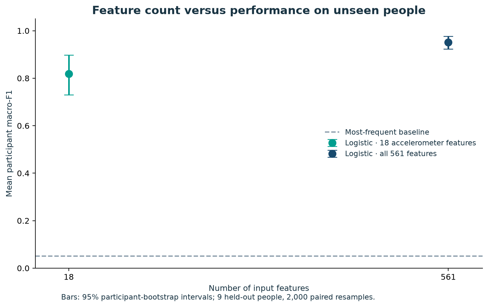
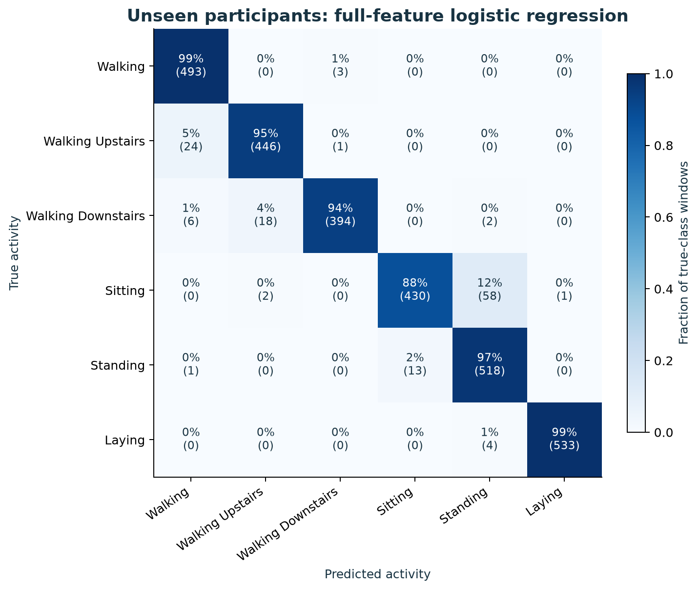

# Wearable Activity Recognition

**Generalization to unseen participants and a compact sensor-feature comparison**  
**Dr. Şeyma Bozkurt Uzan**

[](https://colab.research.google.com/github/Seymabu/wearable-activity-analysis/blob/main/notebooks/01_Wearable_Activity_Recognition.ipynb)

[English](README.md) · [Türkçe açıklama](README_TR.md) · [Model card](MODEL_CARD.md) · [Data attribution](DATA_LICENSE.md)

An independent, reproducible biomedical engineering study by Dr. Şeyma Bozkurt Uzan: use waist-mounted smartphone measurements to distinguish six activities in people excluded from model development. The workflow connects a biomedical question to a baseline, a controlled feature-set comparison and an engineering interpretation.

## Main finding

The full model achieved a mean participant macro-F1 of **0.952**. A prespecified 18-feature accelerometer representation achieved **0.818**. Reducing the feature count by **96.8%** accompanied a **13.4 percentage-point decrease** in mean participant macro-F1 on the same nine test participants.

This comparison changes both sensor-feature families and representation complexity. It does not isolate the effect of removing the gyroscope, and device energy use or latency was not measured.

| Model | Mean participant macro-F1 | 95% participant-bootstrap interval | Pooled accuracy |
|---|---:|---:|---:|
| Most-frequent baseline | 0.051 | 0.049–0.053 | 0.182 |
| Logistic regression: all 561 features | 0.952 | 0.923–0.977 | 0.955 |
| Logistic regression: 18 accelerometer features | 0.818 | 0.730–0.897 | 0.843 |

The paired compact-minus-full difference is **−0.134**, with a 95% interval of **−0.199 to −0.070**. These descriptive intervals resample nine participants and are conditional on the fitted models and this split. They do not capture training uncertainty or establish clinical-population performance. Values come from [the executed analysis](results/metrics.json).



## Biomedical question and data

The [UCI Human Activity Recognition Using Smartphones dataset](https://doi.org/10.24432/C54S4K) contains 10,299 windows from 30 volunteers and 561 engineered features. Activities are walking, walking upstairs, walking downstairs, sitting, standing and lying down. Signals were sampled at 50 Hz, with 2.56-second windows and 50% overlap. The retained official split contains 21 training participants and nine test participants.

This is an activity-monitoring benchmark. There are no patient outcomes, rehabilitation assessments or falls in the target labels. The project demonstrates measurement and validation choices relevant to wearable biomedical systems; it is not a clinical evaluation or a peer-reviewed study.

## Study design

1. Audit the source archive, feature names, labels, missingness and participant separation. Preserve original feature indices because 84 feature-name entries repeat.
2. Compare a most-frequent baseline with standardized logistic regression using all 561 features.
3. Repeat logistic regression with 18 prespecified time-domain accelerometer features: `tBodyAcc`, `tGravityAcc` and `tBodyAccJerk`, each with mean/std for X/Y/Z.
4. Select regularization from `C = [0.01, 0.1, 1, 10]` using five-fold participant-grouped cross-validation on the training set. Each training person has equal weight in the selection metric. Selected C values are 1.0 and 0.1, respectively.
5. Evaluate both prespecified models on the same official test participants. Report pooled metrics, each participant's macro-F1 and 2,000 paired participant-bootstrap replicates, using seed 571.

Our fitted scaler stays inside training folds. The released features already contain the creators' filtering, extraction and normalization; the archive does not establish train-only fitting of every upstream transformation. Correlated windows from one person are never treated as independent bootstrap units.



## Run in Colab or locally

Open the notebook above and run its cells in order. The notebook follows the analysis workflow **question → methods → implementation → controlled comparison → biomedical interpretation**.

For local execution, Python 3.12 was tested:

```bash
git clone https://github.com/Seymabu/wearable-activity-analysis.git
cd wearable-activity-analysis
python -m venv .venv
source .venv/bin/activate
python -m pip install -r requirements.txt
python -m src.analysis --data-dir data --output-dir results
python -m unittest discover -s tests -v
```

Use `requirements-lock.txt` for the recorded analysis dependency versions. Compatible ranges in `requirements.txt` permit other environments, but small numerical differences are possible. Windows users can activate with `.venv\Scripts\activate`.

The first run downloads approximately 61 MB from UCI and verifies the original ZIP payload checksum. Raw data stay in the ignored `data/` directory. A CPU is sufficient; a GPU is not required. To execute a notebook locally, additionally install `nbformat>=5.10,<6`, `nbclient>=0.10,<1` and `ipykernel>=6,<8`.

## Repository contents

- `notebooks/01_Wearable_Activity_Recognition.ipynb`: executed analysis notebook and interpretation.
- `src/analysis.py`: source downloader, audits, training, evaluation and figures.
- `tests/test_analysis.py`: checks for participant leakage, scaling, metric weighting, paired uncertainty and feature definitions.
- `results/`: CSV/JSON results, feature manifest and five figures in PNG/SVG formats.
- `MODEL_CARD.md`: intended use, evaluation and limitations.

## Attribution and reuse

The original analysis code is MIT-licensed. The source dataset has separate rights: the current UCI page lists CC BY 4.0, while the historical archive contains a noncommercial statement. The repository downloads data from the provider and does not redistribute or relicense the archive. See [DATA_LICENSE.md](DATA_LICENSE.md).

Dataset: Reyes-Ortiz, Anguita, Ghio, Oneto and Parra (2013), [Human Activity Recognition Using Smartphones](https://doi.org/10.24432/C54S4K).  
Original study: Anguita et al. (2013), [A Public Domain Dataset for Human Activity Recognition Using Smartphones](https://www.esann.org/sites/default/files/proceedings/legacy/es2013-84.pdf).  
Implementation reference: [scikit-learn grouped cross-validation](https://scikit-learn.org/stable/modules/generated/sklearn.model_selection.StratifiedGroupKFold.html).
