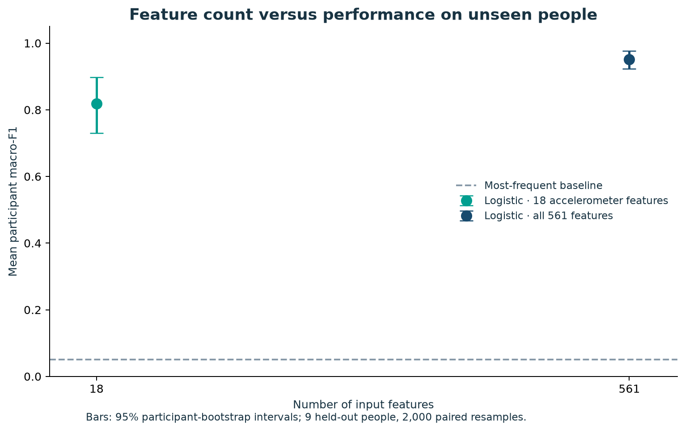

# Giyilebilir Sensör Verileriyle Aktivite Tanıma

**Dr. Şeyma Bozkurt Uzan**

[Colab'da aç](https://colab.research.google.com/github/Seymabu/wearable-activity-analysis/blob/main/notebooks/01_Wearable_Activity_Recognition.ipynb) · [English](README.md)

Dr. Şeyma Bozkurt Uzan’ın bu bağımsız çalışmasında temel soru şu: **Bir model, eğitim sırasında hiç görmediği kişilerin hareketlerini ne kadar iyi tanıyabilir? Daha az sensör özelliği kullanırsak performans nasıl değişir?**

## Biyomedikal mühendislik bağlantısı

Bel bölgesine yerleştirilen telefonun ivmeölçer ve jiroskopundan çıkarılan özelliklerle altı aktivite sınıflandırılıyor: yürüme, merdiven çıkma, merdiven inme, oturma, ayakta durma ve uzanma. Bu örnek hareket izleme, biyomekanik, ölçüm kalitesi ve cihaz tasarımıyla ilişki kuruyor. Veriler klinik hasta sonuçları içermiyor; rehabilitasyon başarısı veya tanı doğruluğu ölçülmüyor.

[UCI veri setindeki](https://doi.org/10.24432/C54S4K) 30 kişinin 21'i eğitimde, dokuzu testte tutuldu. Toplam 10.299 ölçüm penceresi var. Aynı kişinin birbirine benzeyen pencerelerini eğitim ve test arasında karıştırmıyoruz.

## Gerçek analiz sonuçları

| Model | Kişi bazında ortalama macro-F1 | %95 kişi bootstrap aralığı | Tüm test pencerelerinde doğruluk |
|---|---:|---:|---:|
| En sık sınıfı seçen başlangıç modeli | 0,051 | 0,049–0,053 | 0,182 |
| 561 özellikli lojistik regresyon | 0,952 | 0,923–0,977 | 0,955 |
| 18 ivmeölçer özellikli lojistik regresyon | 0,818 | 0,730–0,897 | 0,843 |

Özellik sayısı **%96,8 azalırken**, kişi bazında ortalama macro-F1 **13,4 yüzde puan düştü**. Azaltılmış model ile tam model arasındaki eşleştirilmiş fark −0,134; %95 aralığı −0,199 ile −0,070.

Bu deney aynı anda hem kullanılan sensör özelliklerini hem de temsilin karmaşıklığını değiştiriyor. Farkın tamamını jiroskobun çıkarılmasına bağlayamayız. Pil tüketimi ve çalışma süresi ölçülmedi.

## Analiz akışı

1. **Biyomedikal soru:** Ölçüm neyi temsil ediyor, hangi aktiviteyi tahmin ediyoruz?
2. **Yöntem:** Sınıflandırma, düzenlileştirme, macro-F1 ve kişiye göre veri ayırma.
3. **Colab uygulaması:** Veriyi inceleme, başlangıç modeli, eğitim verisinde çapraz doğrulama.
4. **Kontrollü deney:** Aynı sınıflandırıcıyı tam ve önceden belirlenmiş 18 özellikli veriyle karşılaştırma.
5. **Biyomedikal yorum:** Hatalar hangi aktivitelerde yoğunlaşıyor ve cihaz tasarımı açısından ne ifade ediyor?

Analiz, doğruluk değerleriyle birlikte ölçümün kaynağını, veri bölme yöntemini ve sonuçların sınırlarını açıklıyor. Ek deneylerin yöntemlerini eğitim verisinde belirlemek gerekir; aynı test grubuna bakarak modeli tekrar tekrar iyileştirmek güvenilir değerlendirmeyi bozar.

## Güvenilirlik ve sınırlar

Düzenlileştirme ayarı, yalnızca eğitimdeki kişiler üzerinde beş parçalı grup çapraz doğrulamayla seçildi. Ek ölçekleme her eğitim parçasında öğrenildi. Kaynak verideki özellikler ise veri üreticileri tarafından önceden işlenmiş ve normalize edilmiş; bu işlemlerin tamamının eğitim verisiyle sınırlı olduğunu iddia etmiyoruz.

Belirsizlik hesabında tek tek pencereler yerine dokuz kişi yeniden örnekleniyor. Aralıklar bu küçük test grubuna ve eğitilmiş modellere bağlı; yeni bir klinik topluluğa genellenemez. Bu çalışma bağımsız ve tekrar çalıştırılabilir bir analizdir; hakemli yayın değildir.

## Çalıştırma ve kaynaklar

Colab bağlantısından notebook'u açıp hücreleri sırasıyla çalıştırabilirsin. Yerel kurulum, test komutları ve dosya açıklamaları [İngilizce README](README.md) içinde. Sayısal sonuçların kaynağı [metrics.json](results/metrics.json).

Kodun lisansı MIT; veri hakları ayrıdır. Güncel UCI sayfasındaki CC BY 4.0 bilgisi ile eski arşivdeki ticari kullanım ifadesi farklı olduğu için ham veri GitHub'a yüklenmiyor; doğrudan sağlayıcıdan indiriliyor. Ayrıntı: [veri lisansı ve atıf](DATA_LICENSE.md).
